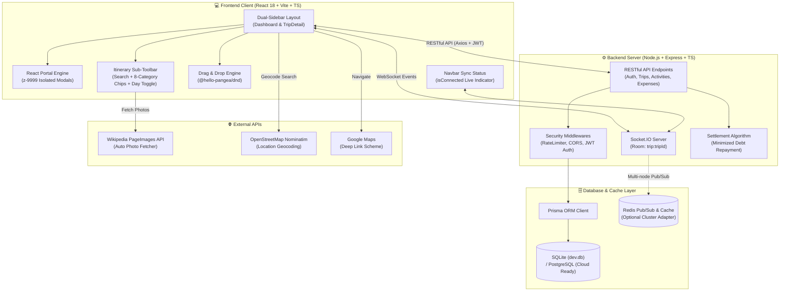
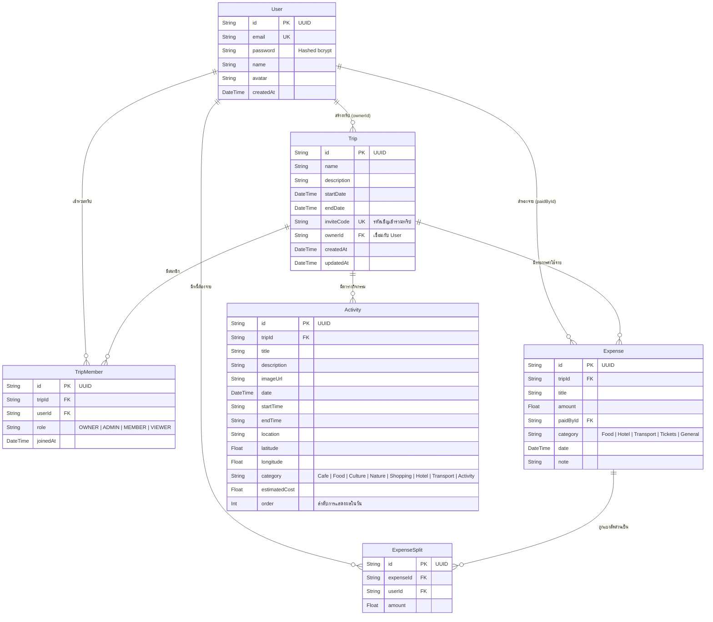

# 🧭 TripSync — Real-time Collaborative Trip Planner

> **"Plan together. Travel together."**  
> เว็บแอปพลิเคชันวางแผนการท่องเที่ยวแบบ **Real-time Collaborative** สำหรับกลุ่มเพื่อน ครอบครัว หรือทีมเดินทาง ช่วยให้ทุกคนร่วมกันวางแผนการเดินทาง (Itinerary), ลากสลับกิจกรรมแบบ Drag & Drop, ดูภาพสถานที่จริงผ่าน Visual Travel Board พร้อมเปิดนำทางบน Google Maps, บันทึกค่าใช้จ่ายและคำนวณสรุปการโอนเงินคืน (Debt Settlement) ได้แบบสดๆ พร้อมกันอย่างไร้รอยต่อ

---

## 📌 สารบัญ (Table of Contents)

1. [แนวคิดและภาพรวมของระบบ (Project Overview)](#1-แนวคิดและภาพรวมของระบบ-project-overview)
2. [ฟีเจอร์หลักและการทำงานของระบบ (Key Features & Functionality)](#2-ฟีเจอร์หลักและการทำงานของระบบ-key-features--functionality)
   * 2.1 [ระบบยืนยันตัวตนและความปลอดภัย (Authentication)](#21-ระบบยืนยันตัวตนและความปลอดภัย-authentication)
   * 2.2 [หน้าหลัก Dashboard & แถบเครื่องมือจัดการทริปฝั่งซ้าย (Left Sidebar Toolbar)](#22-หน้าหลัก-dashboard--แถบเครื่องมือจัดการทริปฝั่งซ้าย-left-sidebar-toolbar)
   * 2.3 [หน้ารายละเอียดทริป (TripDetail) & แถบเครื่องมือนำทางด้านซ้าย](#23-หน้ารายละเอียดทริป-tripdetail--แถบเครื่องมือนำทางด้านซ้าย)
   * 2.4 [ตารางแผนการเดินทางอัจฉริยะ (Itinerary Planner) & ซับทูลบาร์กรองกิจกรรม](#24-ตารางแผนการเดินทางอัจฉริยะ-itinerary-planner--ซับทูลบาร์กรองกิจกรรม)
   * 2.5 [บอร์ดภาพสถานที่และการนำทาง (Visual Travel Board & Gallery)](#25-บอร์ดภาพสถานที่และการนำทาง-visual-travel-board--gallery)
   * 2.6 [ระบบบันทึกและเฉลี่ยค่าใช้จ่าย (Expense Tracker & Debt Settlement)](#26-ระบบบันทึกและเฉลี่ยค่าใช้จ่าย-expense-tracker--debt-settlement)
   * 2.7 [การจัดการสมาชิกและสิทธิ์การเข้าถึง (Member Roles & Invite Code)](#27-การจัดการสมาชิกและสิทธิ์การเข้าถึง-member-roles--invite-code)
3. [สถาปัตยกรรม UI/UX — React Portal, Toolbars & Mobile-First](#3-สถาปัตยกรรม-uiux--react-portal-toolbars--mobile-first)
   * 3.1 [React Portal Architecture (`createPortal`) แก้ปัญหา Modal ติดในวัน/กล่อง](#31-react-portal-architecture-createportal-แก้ปัญหา-modal-ติดในวันกล่อง)
   * 3.2 [Responsive Dual-Sidebar Layout & Mobile Bottom Navigation](#32-responsive-dual-sidebar-layout--mobile-bottom-navigation)
   * 3.3 [FeedLoop Design System & มาตรฐาน Mobile Touch Targets](#33-feedloop-design-system--มาตรฐาน-mobile-touch-targets)
4. [ระบบ Real-time Synchronization & Socket.IO State](#4-ระบบ-real-time-synchronization--socketio-state)
5. [การรับมือโหลดสูงและการรักษาความปลอดภัย (Security & High Concurrency)](#5-การรับมือโหลดสูงและการรักษาความปลอดภัย-security--high-concurrency)
6. [สถาปัตยกรรมระบบและเทคโนโลยี (System Architecture & Tech Stack)](#6-สถาปัตยกรรมระบบและเทคโนโลยี-system-architecture--tech-stack)
7. [โครงสร้างโฟลเดอร์โปรเจกต์ (Project Directory Tree)](#7-โครงสร้างโฟลเดอร์โปรเจกต์-project-directory-tree)
8. [โครงสร้างฐานข้อมูล (Database Schema - Prisma)](#8-โครงสร้างฐานข้อมูล-database-schema---prisma)
9. [รายการ REST API Endpoints](#9-รายการ-rest-api-endpoints)
10. [คู่มือการติดตั้งและรันระบบ (Getting Started Guide)](#10-คู่มือการติดตั้งและรันระบบ-getting-started-guide)
11. [แนวทางการนำขึ้น Production และแผนงานในอนาคต (Deployment & Roadmap)](#11-แนวทางการนำขึ้น-production-และแผนงานในอนาคต-deployment--roadmap)

---

## 1. แนวคิดและภาพรวมของระบบ (Project Overview)

การวางแผนเที่ยวแบบกลุ่มมักเจอปัญหากลุ่มแชทที่คุยกันจนข้อมูลจม แผนตาราง Excel ที่อัปเดตไม่พร้อมกัน ไม่มีรูปประกอบสถานที่จริง และความยุ่งยากในการเคลียร์เงินหารค่าใช้จ่ายหลังจบทริป **TripSync** ถูกสร้างขึ้นเพื่อเป็นคำตอบแบบ **All-in-One Workspace for Travel Groups**:

* **Sync ทันทีที่ขยับ:** แก้ไขข้อมูล ลากสลับสถานที่ เพิ่มค่าใช้จ่าย หรือเปลี่ยนวันเดินทาง ทุกคนในทริปจะเห็นการเปลี่ยนแปลงพร้อมกันทันทีแบบ Real-time
* **แถบเครื่องมือซ้ายมือ (Left Sidebar Toolbars):** จัดหมวดหมู่การค้นหา กรองสถานะ และควบคุมระบบไว้ด้านซ้ายมืออย่างเป็นสัดส่วน มองเห็นง่าย ใช้งานสะดวกตามหลัก Ergonomics
* **จัดทริปสนุกด้วย Drag & Drop:** ลากกิจกรรมสลับเวลาภายในวัน หรือย้ายข้ามวันเดินทางได้อย่างอิสระ
* **ค้นหาสถานที่จริงและดึงรูปอัตโนมัติ:** ค้นหาจุดท่องเที่ยวจริงในไทยผ่าน OpenStreetMap และดึงภาพถ่ายสถานที่ความละเอียดสูงจาก Wikipedia API มาใส่ให้ในคลิกเดียว
* **หารค่าใช้จ่ายอัจฉริยะ (Debt Settlement Algorithm):** บันทึกค่าใช้จ่ายรายคน เลือกว่าใครหารบ้าง และระบบจะคำนวณเส้นทางการโอนเงินคืนที่สั้นและน้อยครั้งที่สุด
* **Mobile-First & React Portal:** รองรับการใช้งานจริงระหว่างเดินทางบนสมาร์ทโฟนเต็มรูปแบบ พร้อมโมดอลและป๊อปอัปอิสระไม่ติดกรอบซ้อนทับ

---

## 2. ฟีเจอร์หลักและการทำงานของระบบ (Key Features & Functionality)

### 🔐 2.1 ระบบยืนยันตัวตนและความปลอดภัย (Authentication)
* **Register & Login:** สมัครสมาชิกและเข้าสู่ระบบด้วยอีเมลและรหัสผ่าน มีการตรวจสอบความถูกต้องของข้อมูล (Validation) และแฮชรหัสผ่านด้วย `bcryptjs` (Salt Rounds 10)
* **JWT Session (JSON Web Token):** ยืนยันตัวตนผ่าน Bearer Token มีอายุการใช้งาน 7 วัน เก็บใน `localStorage` และมีระบบตรวจสอบสถานะเซสชันอัตโนมัติผ่าน `GET /api/auth/me`
* **Auto Redirect:** ป้องกันการเข้าถึงหน้าที่มีการป้องกัน (Protected Route) และส่งกลับไปหน้า Login หากเซสชันหมดอายุ
* **Modern UI:** หน้าลงทะเบียนและล็อกอินมาพร้อมพื้นหลังวิวธรรมชาติความคมชัดสูง สไตล์ Glassmorphism เรียบหรู

---

### 🧳 2.2 หน้าหลัก Dashboard & แถบเครื่องมือจัดการทริปฝั่งซ้าย (Left Sidebar Toolbar)

หน้า Dashboard ได้รับการออกแบบเลย์เอาต์ใหม่เป็น **2 คอลัมน์ (Left Sidebar + Main Content)** เพื่อความสะดวกสบายและรวดเร็วในการจัดการทริป:

```
+-----------------------------------------------------------------------------------+
| Navbar: โลโก้ TripSync  |  🟢 ซิงค์สด  |  ชื่อผู้ใช้  |  ปุ่มออกจากระบบ            |
+----------------------+------------------------------------------------------------+
| [ Left Sidebar ]     | [ Billboard Banner 970x250 (Gradient #0F172A - #1E3A8A) ] |
| - ปุ่ม "+ สร้างทริป" |------------------------------------------------------------+
| - ปุ่ม "เข้าร่วมทริป" | [ Grid การ์ดทริป (Trip Cards) ]                            |
| - ช่องค้นหาทริป      | +------------------+ +------------------+ +--------------+ |
| - ฟิลเตอร์สถานะ      | | 🟢 เชียงใหม่หนาวมาก | | 🕒 ทริปญี่ปุ่นใบไม้ | | 🏁 พัทยาคลายร้อน| |
|   * ทั้งหมด (All)     | | วันที่, สมาชิก, งบ  | | วันที่, สมาชิก, งบ  | | วันที่, สมาชิก...| |
|   * กำลังเดินทาง (Live)| +------------------+ +------------------+ +--------------+ |
|   * เร็วๆ นี้ (Upcoming)                                                          |
|   * จบทริปแล้ว (Past) |                                                            |
| - ฟิลเตอร์บทบาท      |                                                            |
|   * ฉันสร้าง / เข้าร่วม |                                                            |
| - ตัวเลือกการเรียงลำดับ |                                                            |
+----------------------+------------------------------------------------------------+
```

1. **แถบเครื่องมือฝั่งซ้าย (Left Sidebar Toolbar):**
   * **ปุ่มลัดการทำงานหลัก (Quick Actions):**
     * ปุ่ม **"+ สร้างทริปใหม่"** (สีน้ำเงินโดดเด่น) สำหรับเริ่มวางแผนทริปใหม่
     * ปุ่ม **"เข้าร่วมด้วยรหัส"** (ไอคอนกุญแจ) สำหรับกรอก Invite Code 6 ตัวอักษร/UUID
   * **ค้นหาทริปแบบเรียลไทม์ (Live Search):** พิมพ์ค้นหาตามชื่อทริป หรือชื่อจังหวัด/สถานที่ปลายทาง ระบบจะกรองผลลัพธ์ทันที
   * **ตัวกรองสถานะทริป (Trip Status Filters with Live Badges):**
     * 🌐 **ทั้งหมด (All):** แสดงทริปทั้งหมด พร้อมแสดงตัวเลขนับจำนวนทริป
     * 🟢 **กำลังเดินทาง (Ongoing):** กรองเฉพาะทริปที่อยู่ในช่วงวันที่เดินทางปัจจุบัน พร้อมไฟกระพริบสีเขียว (Pulsing Green Dot)
     * 🕒 **เร็วๆ นี้ (Upcoming):** กรองทริปที่มีกำหนดการเดินทางในอนาคต
     * 🏁 **จบทริปแล้ว (Past):** กรองทริปที่วันสิ้นสุดผ่านพ้นไปแล้ว
   * **ตัวกรองบทบาทของฉัน (My Role Filter):**
     * ทั้งหมด / ทริปที่ฉันสร้างเอง (Owner) / ทริปที่เข้าร่วม (Member)
   * **การเรียงลำดับทริป (Sorting Options):**
     * 📅 **วันเดินทางเร็วที่สุด (Nearest Date):** เรียงทริปที่ใกล้ถึงวันเดินทางขึ้นก่อน
     * ⏱️ **สร้างล่าสุด (Newest Created):** เรียงตามเวลาที่สร้างทริป
     * 🔤 **ชื่อทริป (A-Z / ก-ฮ):** เรียงตามตัวอักษรของชื่อทริป
2. **ป้ายแบนเนอร์บิลบอร์ด (Billboard Banner):**
   * แบนเนอร์ขนาดสากล 970x250 พิกเซล พื้นหลังเกรเดียนท์คมชัดระดับอัลตรามินิมอล (`#0F172A` ถึง `#1E3A8A`) ตัดขอบขาวของภาพออกอย่างประณีต กลมกลืน สบายตา ไม่แย่งสายตาของเนื้อหา
3. **การ์ดทริป (Interactive Trip Cards):**
   * แสดงรูปปกสถานที่อัตโนมัติประจำเมือง (Auto Hero Cover เช่น กรุงเทพฯ, เชียงใหม่, ภูเก็ต, ญี่ปุ่น ฯลฯ)
   * แสดงป้ายสถานะสด (Live Badge: กำลังเดินทาง / อีก X วัน / ผ่านมาแล้ว)
   * แสดงสิทธิ์ของผู้ใช้ (`เจ้าของทริป` หรือ `สมาชิกร่วมทริป`), ช่วงวันที่, จำนวนวันรวม, สมาชิกร่วมทริปพร้อมรูปอวาตาร์ และงบประมาณโดยรวม
   * ปุ่มเมนูทางลัด (`...`): คัดลอกรหัสเชิญ, แก้ไขทริป, ออกจากทริป หรือลบทริป

---

### 🧳 2.3 หน้ารายละเอียดทริป (TripDetail) & แถบเครื่องมือนำทางด้านซ้าย

เมื่อคลิกเข้าสู่ทริป ระบบจะโหลดข้อมูลทริปทั้งหมดและเชื่อมต่อ WebSocket เฉพาะห้องทริปนั้น (`trip:<tripId>`):

* **Left Sidebar Navigation Toolbar (ฝั่งซ้ายของจอคอมพิวเตอร์):**
  * **แท็บเปลี่ยนโหมดแนวตั้ง (Vertical Nav Tabs):**
    * 📅 **แผนการเดินทาง (Itinerary):** ตารางและกิจกรรมในแต่ละวัน
    * 📸 **บอร์ดภาพสถานที่ (Visual Gallery):** แกลเลอรีภาพสถานที่ท่องเที่ยวและปุ่มนำทาง
    * 💰 **ค่าใช้จ่ายและเคลียร์เงิน (Expenses):** บันทึกบิล รายรับ-รายจ่าย และสรุปยอดโอนคืน
    * 👥 **สมาชิกทริป (Members):** จัดการสิทธิ์ เชิญเพื่อน และดูสถานะ
  * **กล่อง Live Sync & Presence Indicator:**
    * แสดงไฟสถานะสีเขียวกระพริบ `🟢 ซิงค์สด (Real-time Active)`
    * แสดงอวาตาร์ของสมาชิกในทริปที่กำลังทำงานอยู่
  * **วิดเจ็ตรหัสคำเชิญ (1-Click Invite Code):**
    * แสดงรหัสเชิญของทริปแบบตัวพิมพ์ใหญ่ชัดเจน
    * ปุ่มคัดลอกรหัสในคลิกเดียว (พร้อม Toast แจ้งเตือน)
    * ปุ่มแชร์ทริป (Web Share API) ส่งเข้า LINE หรือ Messenger ได้ทันที
  * **ปุ่มพิมพ์/ส่งออกเอกสาร (Print & Export PDF):**
    * สั่งพิมพ์ตารางทริปออกเครื่องพิมพ์หรือบันทึกเป็น PDF ที่จัดหน้ากระดาษสวยงาม ไร้ส่วนเกินของเมนู
  * **เมนูจัดการทริป:** แก้ไขข้อมูลทริป, ลบทริป (สำหรับเจ้าของ), หรือออกจากทริป
* **Hero Cover Banner:**
  * ภาพหน้าปกความละเอียดสูง ตรวจจับตามชื่อจังหวัด/ประเทศอัตโนมัติ
  * แสดงชื่อทริป, วันเดินทาง, สถานะทริป, จำนวนวันรวม, และงบประมาณรวมทั้งทริปแบบคำนวณสด
* **Mobile Floating Bottom Action Bar:**
  * สำหรับหน้าจอมือถือ แถบเครื่องมือจะเปลี่ยนเป็น Floating Bottom Bar ด้านล่างสุด ให้ใช้นิ้วโป้งกดสลับโหมด 4 แท็บได้คล่องตัวเสมือนแอป Native

---

### 📅 2.4 ตารางแผนการเดินทางอัจฉริยะ (Itinerary Planner) & ซับทูลบาร์กรองกิจกรรม

ตารางแผนการเดินทางได้รับการอัปเกรดให้มี **Itinerary Sub-Toolbar** อยู่เหนือตารางวัน:

1. **Sub-Toolbar กรองกิจกรรมอัจฉริยะ:**
   * **ค้นหากิจกรรม (Activity Search):** ค้นหากิจกรรมหรือสถานที่ในทุกวันได้แบบทันที (Real-time Filter)
   * **ชิปกรองหมวดหมู่พร้อมตัวเลขนับสด (Category Filter Chips with Live Counts):**
     * `ทั้งหมด` (แสดงยอดรวมทั้งหมด)
     * `☕ คาเฟ่ (Cafe)`
     * `🍜 อาหาร (Food)`
     * `🏯 วัฒนธรรม (Culture)`
     * `🌄 ธรรมชาติ (Nature)`
     * `🛍️ ช้อปปิ้ง (Shopping)`
     * `🏨 ที่พัก (Hotel)`
     * `🚗 เดินทาง (Transport)`
     * `🎯 กิจกรรม (Activity)`
     * แต่ละชิปจะมีตัวเลขบอกว่ามีกิจกรรมหมวดนี้กี่รายการในทริป
   * **ปุ่มย่อ/ขยายทุกวัน (Expand All / Collapse All):** ยุบหรือกางตารางของทุกวันได้ในคลิกเดียว ช่วยให้เห็นภาพรวมของทริปที่ยาวหลายสัปดาห์ได้ง่าย
   * **ปุ่ม "+ เพิ่มวันเดินทาง":** เพิ่มวันเดินทางต่อท้ายได้ทันทีจากซับทูลบาร์
2. **ระบบจัดการวันเดินทาง (Day Accordion & Management):**
   * แยกตารางตามวัน (`Day 1 — 12 พ.ย.`, `Day 2 — 13 พ.ย.`, ...)
   * สามารถกดปุ่มลูกศรเพื่อยุบ/ขยายเฉพาะวันที่ต้องการได้อิสระ
   * ปุ่ม **"+ เพิ่มกิจกรรม"** ประจำวัน และปุ่ม **"ลบวัน"** ที่จะปรับช่วงเวลาและย้ายกิจกรรมให้อัตโนมัติ
   * สรุปงบประมาณรวมประจำวันนั้นๆ ให้เห็นทันที
3. **Drag & Drop Reordering (`@hello-pangea/dnd`):**
   * ลากสลับกิจกรรมเปลี่ยนเวลาภายในวันเดียวกัน
   * ลากย้ายข้ามวันเดินทาง พร้อมบันทึกลงฐานข้อมูลและส่งสัญญาณ WebSocket ให้อุปกรณ์อื่นอัปเดตตามทันที
4. **ค้นหาพิกัดและดึงรูปภาพสถานที่อัตโนมัติ:**
   * เชื่อมต่อ **OpenStreetMap Nominatim** ค้นหาชื่อสถานที่จริงในไทยเพื่อดึงพิกัด ละติจูด/ลองจิจูด
   * ปุ่ม **"🔍 ดึงรูปอัตโนมัติจากชื่อ"** เชื่อมต่อ **Wikipedia API** ดึงภาพถ่ายสถานที่ท่องเที่ยวของจริงความละเอียดสูงมาใส่ในการ์ดกิจกรรมทันที
   * รองรับการอัปโหลดรูปภาพจากอุปกรณ์ พร้อมระบบบีบอัดภาพอัตโนมัติผ่าน Canvas API

---

### 📸 2.5 บอร์ดภาพสถานที่และการนำทาง (Visual Travel Board & Gallery)

* **Visual Grid Layout:** รวมรูปภาพสถานที่ทั้งหมดที่เพิ่มไว้ในแผนการเดินทางมาแสดงผลเป็นการ์ดรูปภาพสวยงาม
* **Filter Bar:** เลือกว่าจะดูภาพของทุกวัน หรือเจาะจงเฉพาะ `Day 1`, `Day 2` หรือเลือกดูเฉพาะหมวดหมู่ (เช่น เฉพาะคาเฟ่ หรือเฉพาะร้านอาหาร)
* **Lightbox Preview:** คลิกที่ภาพเพื่อเปิดดูรูปขนาดใหญ่เต็มจอ พร้อมรายละเอียดและงบประมาณ
* **ปุ่มเปิดนำทางใน Google Maps:** ทุกการ์ดสถานที่มาพร้อมปุ่มสีน้ำเงินที่จะเปิดแอป **Google Maps** บนสมาร์ทโฟน หรือเบราว์เซอร์ เพื่อเริ่มนำทางไปยังพิกัดหรือชื่อสถานที่นั้นได้ทันทีโดยไม่ต้องก็อปปี้ไปค้นหาเอง

---

### 💰 2.6 ระบบบันทึกและเฉลี่ยค่าใช้จ่าย (Expense Tracker & Debt Settlement)

* **บันทึกบิลค่าใช้จ่าย:** ระบุชื่อรายการ, ยอดเงิน, หมวดหมู่, สมาชิกที่เป็นคนสำรองจ่าย (`paidBy`), และสามารถเลือกติ๊กได้ว่า **ใครบ้างที่ร่วมหารในบิลนี้**
* **สรุปภาพรวมทางการเงิน (Financial Stats):**
  * ยอดรวมค่าใช้จ่ายจริงทั้งทริป
  * ค่าใช้จ่ายเฉลี่ยต่อคน
  * รายการใช้จ่ายแบ่งตามหมวดหมู่
* **สถานะดุลการเงินสุทธิรายบุคคล (Net Balances):**
  * คำนวณว่าแต่ละคนจ่ายไปเท่าไหร่ หารไปเท่าไหร่
  * สรุปว่าแต่ละคนมีสถานะเป็นเจ้าหนี้ (`+ ยอดสีเขียว`) หรือลูกหนี้ (`- ยอดสีแดง`)
* **อัลกอริทึมเคลียร์หนี้อัจฉริยะ (Smart Debt Settlement Algorithm):**
  * แก้ปัญหาการโอนเงินวนไปวนมาในกลุ่ม ด้วยการคำนวณจับคู่ผู้ที่ต้องจ่ายกับผู้ที่ต้องได้รับเงิน เพื่อให้เกิดการโอนเงินจำนวนครั้งน้อยที่สุด เช่น *"นาย A โอนให้นาย B จำนวน 350.00 บาท"*

---

### 👥 2.7 การจัดการสมาชิกและสิทธิ์การเข้าถึง (Member Roles & Invite Code)

* **ระบบบทบาท (Role-Based Access Control - RBAC):**
  * 👑 **`OWNER` (เจ้าของทริป):** สิทธิ์สูงสุด ลบทริป, แก้ไขข้อมูลทริป, จัดการและเปลี่ยน Role สมาชิก, เพิ่ม/ลบกิจกรรมและค่าใช้จ่าย
  * ⚡ **`ADMIN` (ผู้ดูแลร่วม):** แก้ไขข้อมูลทริป, ลบสมาชิกทั่วไป, เพิ่ม/ลบกิจกรรมและค่าใช้จ่าย
  * 👤 **`MEMBER` (สมาชิก):** เพิ่ม/แก้ไขกิจกรรมของตนเอง, บันทึกค่าใช้จ่าย, ร่วมหารเงิน, และออกจากทริปได้
  * 👁️ **`VIEWER` (ผู้ชม):** ดูข้อมูลตารางและภาพได้อย่างเดียว
* **การเชิญเข้าทริป:** ส่งรหัส Invite Code ให้เพื่อนกรอกในหน้า Dashboard เพื่อเข้าร่วมทริปได้ทันที

---

## 3. สถาปัตยกรรม UI/UX — React Portal, Toolbars & Mobile-First

### 3.1 React Portal Architecture (`createPortal`) แก้ปัญหา Modal ติดในวัน/กล่อง

ในเวอร์ชันก่อนหน้า ป๊อปอัปสำหรับเพิ่มกิจกรรมถูกเรนเดอร์อยู่ภายในแท็ก `<div>` ของวันเดินทางนั้นๆ ส่งผลให้เกิดปัญหา **CSS Stacking Context** และ **Overflow Hidden Clipping** (ป๊อปอัปโดนตัดขอบ หรือแสดงผลผิดตำแหน่งเมื่อหน้าจอเลื่อน)

เราได้ออกแบบสถาปัตยกรรม Modal ใหม่ทั้งหมด โดยย้ายโมดอลทุกตัวในระบบไปเรนเดอร์ที่ Root ของเอกสาร (`document.body`) ผ่าน **`createPortal`** ของ React:

```tsx
// สถาปัตยกรรม React Portal ที่นำมาใช้กับทุก Modal ใน TripSync
import { createPortal } from 'react-dom';

{showAddModal && createPortal(
  <div className="fixed inset-0 z-[9999] flex items-center justify-center p-4 bg-black/60 backdrop-blur-xs overflow-y-auto">
    <div className="bg-white rounded-2xl w-full max-w-lg shadow-2xl p-6 border border-gray-100 animate-in fade-in zoom-in-95">
      {/* เนื้อหาฟอร์มเพิ่ม/แก้ไขกิจกรรม */}
    </div>
  </div>,
  document.body
)}
```

**รายการ Modals ทั้งหมดที่ถูกย้ายสู่ React Portal (`z-[9999]`):**
1. **Add / Edit Activity Modal:** หน้าต่างเพิ่มและแก้ไขสถานที่/กิจกรรม
2. **Lightbox Image Preview:** หน้าต่างดูภาพสถานที่ขยายใหญ่เต็มจอ
3. **Add / Edit Expense Modal:** หน้าต่างบันทึกและแก้ไขบิลค่าใช้จ่าย
4. **Create Trip Modal:** หน้าต่างสร้างทริปใหม่จาก Dashboard
5. **Join Trip Modal:** หน้าต่างกรอกรหัสเข้าร่วมทริป
6. **Edit Trip Modal:** หน้าต่างแก้ไขชื่อ วันที่ และรายละเอียดทริป
7. **Delete Trip Confirmation Modal:** หน้าต่างยืนยันการลบทริป
8. **Leave Trip Confirmation Modal:** หน้าต่างยืนยันการออกจากทริป

**ผลลัพธ์:** ป๊อปอัปทุกบานแสดงผลกลางหน้าจออย่างสมบูรณ์แบบ แบ็กกราวด์เบลอสวยงาม ไม่โดนคอนเทนเนอร์แม่ตัดขอบ เลื่อนหน้าจอได้อิสระบนทุกอุปกรณ์

---

### 3.2 Responsive Dual-Sidebar Layout & Mobile Bottom Navigation

* **Desktop View (`≥ 1024px`):**
  * คอลัมน์ซ้าย (`lg:w-72` หรือ `lg:w-80`) เป็น Sticky Sidebar บรรจุเครื่องมือควบคุม ฟิลเตอร์ และเมนูทั้งหมด อยู่ในตำแหน่งคงที่ขณะที่เนื้อหาฝั่งขวาเลื่อนได้
* **Tablet View (`768px - 1023px`):**
  * แถบเครื่องมือปรับเป็น Horizontal Grid และ Sticky Sub-toolbar ปรับตัวตามความกว้างของหน้าจอ
* **Mobile View (`< 768px`):**
  * ด้านบนสุด: ป้ายสถานะกะทัดรัด
  * กลางจอ: การ์ดเนื้อหาและตารางแบบ Single Column กว้างเต็มจอ
  * ด้านล่างสุด: **Floating Bottom Navigation Bar** มีปุ่ม 4 แท็บหลักพร้อมไอคอน แตะสลับได้ง่ายด้วยนิ้วโป้งเดียว

---

### 3.3 FeedLoop Design System & มาตรฐาน Mobile Touch Targets

* **Minimum 44px Touch Targets:** ปุ่มกด จุดสัมผัส และช่องกรอกข้อมูลทั้งหมดมีความสูงขั้นต่ำ `44px` (ตามมาตรฐาน Apple Human Interface Guidelines และ Google Material Design) ลดปัญหาการกดพลาดบนมือถือ
* **Font Size 16px สำหรับ Input บนมือถือ:** แก้ไขปัญหาเบราว์เซอร์ iOS Safari ขยายซูมหน้าจออัตโนมัติเมื่อแตะช่องกรอกข้อมูล
* **Safe Area Inset Support (`pb-safe`, `pt-safe`):** เว้นระยะขอบล่างสำหรับแถบ Home Bar ของ iPhone รุ่นใหม่ และไม่ถูกรอยบาก (Dynamic Island / Notch) บดบัง

---

## 4. ระบบ Real-time Synchronization & Socket.IO State

TripSync ใช้การเชื่อมต่อแบบ **Bi-directional WebSocket** ผ่าน Socket.IO โดยมีการจัดการ Room แยกตามแต่ละทริป:

```
[ Client A (User 1) ]           [ Node.js Socket.IO Server ]           [ Client B (User 2) ]
        |                                    |                                    |
        |--- emit("join-trip", tripId) ----->| (Join Room: trip:123)              |
        |                                    |<--- emit("join-trip", tripId) -----|
        |                                    |                                    |
        |--- emit("activity-changed") ------>|                                    |
        |    (เพิ่ม/ลากสลับกิจกรรม)               |--- broadcast("activity-updated") ->|
        |                                    |    (สั่งให้ Client B รีเฟรชข้อมูล)      |
        |                                    |                                    |
        |<-- broadcast("expense-updated") ---|--- emit("expense-changed") --------|
        |    (อัปเดตยอดเงินทันที)                  |    (เพิ่มบิลค่าอาหาร 500 บาท)         |
```

### 🟢 Live Connection Indicator ใน Navbar
ใน `SocketContext.tsx` ได้เพิ่มตัวแปรสถานะ `isConnected` ที่คอยดักฟังอีเวนต์ `connect` และ `disconnect`:
* เมื่อเชื่อมต่อสำเร็จ: แสดงป้าย **`🟢 ซิงค์สด`** พร้อมไฟกระพริบ Pulse สีเขียว
* เมื่อสัญญาณขาดหาย: แสดงป้าย **`🟡 กำลังเชื่อมต่อ...`** และพยายาม Reconnect อัตโนมัติ

---

## 5. การรับมือโหลดสูงและการรักษาความปลอดภัย (Security & High Concurrency)

เพื่อรองรับกรณีที่มีผู้ใช้งานจำนวนมากพร้อมกัน หรือมีผู้ไม่หวังดีพยายามโจมตีระบบ TripSync ได้วางโครงสร้างความปลอดภัยและรองรับการขยายตัว (Scalability) ไว้ดังนี้:

### 🛡️ 5.1 การป้องกันการโจมตีและการรักษาความปลอดภัย (Security Measures)
1. **DDoS & Brute-Force Rate Limiting (`express-rate-limit`):**
   * จำกัดจำนวน Request ต่อ IP เช่น หน้า Login/Register จำกัด 10 ครั้งต่อ 15 นาที เพื่อป้องกันการสุ่มรหัสผ่าน
   * ป้องกันการยิงสแปม API ถี่เกินขนาด
2. **SQL Injection Prevention:**
   * ใช้ **Prisma ORM** ซึ่งใช้ระบบ Parameterized Queries 100% ปลอดภัยจากการโจมตีประเภท SQL Injection
3. **CORS & Origin Whitelist:**
   * เซิร์ฟเวอร์อนุญาตเฉพาะคำขอที่ส่งมาจาก Origin ของ Frontend ที่ระบุใน `.env` (`CLIENT_URL`) เท่านั้น
4. **Security Headers (`helmet`):**
   * ซ่อน Header `X-Powered-By: Express` และเปิดใช้ Content Security Policy, XSS Filter, Strict-Transport-Security
5. **Data Validation & Sanitization:**
   * มีการตรวจเช็ก Type, ช่วงของตัวเลข, ค่าว่าง และตัดช่องว่างหรืออักขระแปลกปลอมก่อนนำข้อมูลไปประมวลผล

### ⚡ 5.2 การจัดการเมื่อมีผู้ใช้งานพร้อมกันจำนวนมาก (High Concurrency & Load Balancing)
1. **Stateless JWT Architecture:**
   * เซิร์ฟเวอร์ไม่ต้องเก็บ Session ไว้ใน RAM ทำให้สามารถเพิ่มจำนวนเซิร์ฟเวอร์ (Scale Out) ได้ทันทีโดยผู้ใช้ไม่ต้องล็อกอินใหม่
2. **Socket.IO Redis Adapter (Multi-Instance Scaling):**
   * เมื่อขยายเซิร์ฟเวอร์เป็นหลายเครื่อง (Cluster Mode / Multiple Nodes) สามารถติดตั้ง `@socket.io/redis-adapter` เพื่อให้สัญญาณ Real-time กระจายข้ามเครื่องเซิร์ฟเวอร์หากันได้ผ่าน Redis Pub/Sub
3. **Optimistic UI Updates:**
   * ในการลากวาง Drag & Drop ฝั่ง Frontend จะอัปเดตตำแหน่งกิจกรรมบนหน้าจอทันทีก่อนที่ API จะตอบกลับ ทำให้ผู้ใช้รู้สึกเร็ว ไหลลื่น ไม่หน่วง
4. **Database Connection Pooling:**
   * เมื่อย้ายไปใช้ PostgreSQL บน Cloud (เช่น Supabase, AWS RDS หรือ Neon) สามารถเปิดใช้ PgBouncer / Connection Pool เพื่อรองรับ Concurrent Connections ได้หลายพันการเชื่อมต่อพร้อมกัน

---

## 6. สถาปัตยกรรมระบบและเทคโนโลยี (System Architecture & Tech Stack)



### 🛠️ เทคโนโลยีที่เลือกใช้ (Tech Stack Specs)

| ส่วนของระบบ | รายชื่อเครื่องมือและไลบรารี |
| :--- | :--- |
| **Frontend Framework** | **React 18** + **TypeScript** + **Vite** (เร็วและเบา โหลดแบบ Hot Module Replacement) |
| **UI & Styling** | **Tailwind CSS**, **Lucide React Icons**, **React Hot Toast**, FeedLoop Design Rules |
| **Interactive Components** | **`@hello-pangea/dnd`** (Drag & Drop สำหรับตารางกิจกรรม), **React Portal** |
| **Backend Framework** | **Node.js** + **Express.js** + **TypeScript** |
| **Real-time Engine** | **Socket.IO** (WebSockets พร้อม fallback Polling) |
| **Database & ORM** | **Prisma ORM**, SQLite (Local Development) / PostgreSQL (Production) |
| **Security & Auth** | **JSON Web Token (`jsonwebtoken`)**, **`bcryptjs`**, CORS, Rate Limiter |
| **External APIs** | **Wikipedia REST API**, **OpenStreetMap Nominatim API**, **Google Maps Scheme** |

---

## 7. โครงสร้างโฟลเดอร์โปรเจกต์ (Project Directory Tree)

```text
TripSync/
├── client/                               # ส่วนหน้าบ้าน (Frontend React + Vite + TypeScript)
│   ├── public/
│   │   ├── tripsync_banner.jpg           # แบนเนอร์ขนาดบิลบอร์ด 970x250 (ตัดขอบขาว กลืนกับพื้นหลัง)
│   │   └── vite.svg
│   ├── index.html                        # โครงสร้างหลัก HTML, ฟอนต์ Kanit, Viewport มือถือ
│   ├── package.json
│   ├── tailwind.config.js
│   ├── tsconfig.json
│   ├── vite.config.ts
│   └── src/
│       ├── main.tsx                      # Root Entry Point
│       ├── App.tsx                       # React Router v6, Protected Routes, Toaster
│       ├── index.css                     # Tailwind CSS, FeedLoop Utilities, Animations
│       ├── types/
│       │   └── index.ts                  # TypeScript Interfaces (User, Trip, Activity, Expense, etc.)
│       ├── context/
│       │   ├── AuthContext.tsx           # ระบบจัดการล็อกอิน, ตรวจ JWT, สถานะผู้ใช้
│       │   └── SocketContext.tsx         # จัดการเชื่อมต่อ Socket.IO และส่งสัญญาณ isConnected
│       ├── services/
│       │   └── api.ts                    # Axios Client พร้อม Interceptor แทรก JWT Token อัตโนมัติ
│       ├── utils/
│       │   ├── geoUtils.ts               # ตรวจจับจังหวัด/ประเทศ และค้นหาพิกัด OpenStreetMap
│       │   └── imageUtils.ts             # ดึงรูปจาก Wikipedia และสร้างลิงก์ Google Maps
│       ├── components/
│       │   ├── Navbar.tsx                # แถบเมนูด้านบน พร้อมป้ายไฟเขียว 🟢 ซิงค์สด (Live Status)
│       │   ├── Itinerary/
│       │   │   └── ItineraryView.tsx     # ตารางทริป + Sub-Toolbar กรอง 8 หมวด + Portal Modal
│       │   ├── Expense/
│       │   │   └── ExpenseTracker.tsx    # บันทึกรายจ่าย สรุปยอด และเคลียร์หนี้ + Portal Modal
│       │   ├── Gallery/
│       │   │   └── TripGallery.tsx       # บอร์ดภาพสถานที่ Lightbox Preview + ปุ่ม Google Maps
│       │   └── Members/
│       │       └── MemberList.tsx        # รายชื่อสมาชิก จัดการ Role และคัดลอก Invite Code
│       └── pages/
│           ├── Login.tsx                 # หน้าเข้าสู่ระบบ
│           ├── Register.tsx              # หน้าสมัครสมาชิกใหม่
│           ├── Dashboard.tsx             # หน้าหลักรวมทริป + Left Sidebar Toolbar + ป้ายบิลบอร์ด
│           └── TripDetail.tsx            # หน้ารายละเอียดทริป + Left Navigation Toolbar + Bottom Bar
│
└── server/                               # ส่วนหลังบ้าน (Backend Node.js + Express + Prisma)
    ├── package.json
    ├── tsconfig.json
    ├── .env                              # PORT, DATABASE_URL, JWT_SECRET, CLIENT_URL
    ├── prisma/
    │   ├── schema.prisma                 # สกีมาฐานข้อมูล (User, Trip, TripMember, Activity, Expense...)
    │   └── dev.db                        # ไฟล์ฐานข้อมูล SQLite สำหรับ Development
    └── src/
        ├── index.ts                      # Server Entry Point (Express + HTTP Server + Socket.IO)
        ├── prisma.ts                     # Prisma Client Singleton Instance
        ├── middlewares/
        │   └── authMiddleware.ts         # Middleware ตรวจสอบ JWT Bearer Token และดึง userId
        ├── sockets/
        │   └── tripSocket.ts             # ระบบห้อง Real-time และการกระจาย Broadcast Events
        ├── controllers/
        │   ├── authController.ts         # Logic: Register, Login, GetMe
        │   ├── tripController.ts         # Logic: CRUD ทริป, เพิ่ม/ลบวันเดินทาง, สมาชิก, Invite Code
        │   ├── activityController.ts     # Logic: CRUD กิจกรรม และการ Reorder ตำแหน่งกิจกรรม
        │   └── expenseController.ts      # Logic: บันทึกค่าใช้จ่าย และอัลกอริทึมเคลียร์หนี้
        └── routes/
            ├── authRoutes.ts             # /api/auth
            ├── tripRoutes.ts             # /api/trips
            ├── activityRoutes.ts         # /api/activities
            └── expenseRoutes.ts          # /api/expenses
```

---

## 8. โครงสร้างฐานข้อมูล (Database Schema - Prisma)

ฐานข้อมูลถูกออกแบบให้มีความสัมพันธ์แบบ Relational ครบถ้วน เพื่อความถูกต้องของข้อมูล (Data Integrity):



---

## 9. รายการ REST API Endpoints

ทุก Endpoint ที่เข้าถึงข้อมูลทริป ต้องแนบ Header:  
`Authorization: Bearer <your_jwt_token>`

### 🔐 1. Authentication (`/api/auth`)
| Method | URL | คำอธิบาย |
| :--- | :--- | :--- |
| `POST` | `/api/auth/register` | สมัครสมาชิกใหม่ (ส่ง `name`, `email`, `password`) รับ JWT Token |
| `POST` | `/api/auth/login` | เข้าสู่ระบบด้วย `email` และ `password` รับ JWT Token |
| `GET` | `/api/auth/me` | ดึงข้อมูลโปรไฟล์ผู้ใช้ปัจจุบันจาก JWT Token |

### 🧳 2. Trips & Members (`/api/trips`)
| Method | URL | คำอธิบาย |
| :--- | :--- | :--- |
| `GET` | `/api/trips` | ดึงรายการทริปทั้งหมดของผู้ใช้ (ทั้งที่เป็นเจ้าของและเป็นสมาชิก) |
| `POST` | `/api/trips` | สร้างทริปใหม่ กำหนดชื่อ รายละเอียด วันที่เริ่ม-สิ้นสุด |
| `GET` | `/api/trips/:id` | ดึงข้อมูลทริปแบบละเอียดครบทุกตาราง (สมาชิก, กิจกรรม, ค่าใช้จ่าย) |
| `PUT` | `/api/trips/:id` | แก้ไขข้อมูลทริป (เฉพาะสิทธิ์ Owner / Admin) |
| `DELETE` | `/api/trips/:id` | ลบทริปและข้อมูลที่เกี่ยวข้องทั้งหมดถาวร (เฉพาะ Owner) |
| `POST` | `/api/trips/join` | เข้าร่วมทริปด้วย `inviteCode` |
| `POST` | `/api/trips/:id/add-day` | ขยายเวลาทริปเพิ่มอีก 1 วันต่อท้าย |
| `POST` | `/api/trips/:id/delete-day` | ลบวันเดินทางที่เลือก พร้อมเลื่อนกิจกรรมให้อัตโนมัติ |
| `DELETE` | `/api/trips/:id/members/:memberId` | ลบสมาชิกออกจากทริป หรือสมาชิกกดออกจากทริปตนเอง |
| `PUT` | `/api/trips/:id/members/:memberId/role` | ปรับเปลี่ยน Role ของสมาชิกในทริป |

### 📅 3. Activities (`/api/activities`)
| Method | URL | คำอธิบาย |
| :--- | :--- | :--- |
| `POST` | `/api/activities` | เพิ่มสถานที่หรือกิจกรรมใหม่ลงในวันเดินทาง |
| `PUT` | `/api/activities/reorder` | อัปเดตการจัดเรียงลำดับ (`order`) และวันที่ใหม่จากการ Drag & Drop |
| `PUT` | `/api/activities/:id` | แก้ไขรายละเอียด เวลา พิกัด รูปภาพ หรือค่าใช้จ่ายประมาณการ |
| `DELETE` | `/api/activities/:id` | ลบกิจกรรมออกจากตาราง |

### 💰 4. Expenses & Settlement (`/api/expenses`)
| Method | URL | คำอธิบาย |
| :--- | :--- | :--- |
| `POST` | `/api/expenses` | บันทึกรายจ่ายใหม่ พร้อมระบุคนจ่ายและสมาชิกที่ร่วมหาร |
| `PUT` | `/api/expenses/:id` | แก้ไขรายการค่าใช้จ่ายและคำนวณสัดส่วนการหารใหม่ |
| `DELETE` | `/api/expenses/:id` | ลบรายการค่าใช้จ่าย |
| `GET` | `/api/expenses/summary/:tripId` | ดึงรายงานสรุปดุลสุทธิรายคน (`balances`) และรายการโอนเงินคืน (`settlements`) |

---

## 10. คู่มือการติดตั้งและรันระบบ (Getting Started Guide)

### ความต้องการของระบบ (Prerequisites)
* **Node.js**: เวอร์ชัน 18.0.0 หรือใหม่กว่า
* **npm**: เวอร์ชัน 8.0.0 หรือใหม่กว่า

---

### ขั้นตอนที่ 1: ติดตั้งและรันส่วนหลังบ้าน (Backend Server)

```bash
# 1. เข้าสู่โฟลเดอร์เซิร์ฟเวอร์
cd server

# 2. ติดตั้งแพ็กเกจ Node.js
npm install

# 3. ซิงค์สกีมาฐานข้อมูล SQLite
npx prisma generate
npx prisma db push

# 4. รันเซิร์ฟเวอร์สำหรับพัฒนา (Development Mode)
npm run dev
```
เซิร์ฟเวอร์จะเริ่มทำงานที่ **`http://localhost:5000`** พร้อมเปิดรับการเชื่อมต่อ WebSocket

---

### ขั้นตอนที่ 2: ติดตั้งและรันส่วนหน้าบ้าน (Frontend Client)

เปิดหน้าต่าง Command Prompt หรือ Terminal บานใหม่:

```bash
# 1. เข้าสู่โฟลเดอร์ไคลเอนต์
cd client

# 2. ติดตั้งแพ็กเกจ Node.js
npm install

# 3. รันเว็บแอปพลิเคชันด้วย Vite
npm run dev
```
ไคลเอนต์จะเริ่มทำงานที่ **`http://localhost:5173`**

---

### ขั้นตอนที่ 3: ทดสอบใช้งานจริง
1. เปิดเว็บเบราว์เซอร์ไปที่ **`http://localhost:5173`**
2. กดปุ่ม **"สมัครสมาชิก"** เพื่อสร้างบัญชีทดสอบคนแรก
3. ลองกดปุ่ม **"+ สร้างทริปใหม่"** ที่แถบเครื่องมือด้านซ้ายมือ (เช่น *"ทริปแอ่วเหนือเชียงใหม่ 4 วัน 3 คืน"*)
4. เพิ่มสถานที่ หรือกดดึงรูปภาพอัตโนมัติจาก Wikipedia
5. เปิดแท็บเบราว์เซอร์แบบไม่ระบุตัวตน (Incognito) สมัครบัญชีคนที่สอง แล้วนำ **Invite Code** ไปกดเข้าร่วมทริป เพื่อทดสอบการทำงานของระบบ **Real-time Sync** พร้อมกัน 2 หน้าจอ!

---

## 11. แนวทางการนำขึ้น Production และแผนงานในอนาคต (Deployment & Roadmap)

### 🚀 สรุปขั้นตอนการนำขึ้นระบบจริง (Production Deployment)
1. **Database:** สลับใน `server/prisma/schema.prisma` จาก `provider = "sqlite"` เป็น `provider = "postgresql"` และเชื่อมต่อกับ Cloud PostgreSQL (เช่น Supabase, Neon หรือ Railway)
2. **Backend Server:** โฮสต์บน **Render**, **Railway**, หรือ **Fly.io** (รองรับ Node.js + WebSocket Long Connection)
3. **Frontend Client:** โฮสต์บน **Vercel** หรือ **Netlify** พร้อมตั้งค่า Build Command: `npm run build` และ Environment Variable: `VITE_API_URL` ชี้ไปยัง Backend URL จริง
4. **CI/CD:** เชื่อมต่อ GitHub Repository เพื่อให้ระบบ Build และ Deploy ให้อัตโนมัติทุกครั้งที่มีการ Push โค้ด

### 💡 แผนการพัฒนาในอนาคต (Roadmap)
* 🗳️ **ระบบโหวตสถานที่ (Activity Polling):** ให้สมาชิกในทริปเสนอสถานที่และกดโหวตก่อนนำเข้าตารางหลัก
* 💬 **แชทกลุ่มภายในทริป (In-Trip Real-time Chat):** คุยงานและส่งรูปภาพคุยกันเฉพาะในแต่ละทริป
* 🤖 **AI Smart Route Optimization:** ผู้ช่วย AI แนะนำลำดับสถานที่ที่ช่วยประหยัดเวลาเดินทางมากที่สุดตามพิกัดจริง
* 📱 **QR PromptPay Settlement:** สร้าง QR Code พร้อมเพย์ตามยอดเงินที่ต้องโอนคืนในหน้าคำนวณเงิน ให้เพื่อนสแกนจ่ายได้ทันทีในคลิกเดียว

---

<div align="center">
  <b>TripSync — Plan Together. Travel Together. 🧭</b><br>
  ออกแบบและพัฒนาอย่างพิถีพิถันเพื่อประสบการณ์วางแผนท่องเที่ยวที่ดีที่สุด
</div>
